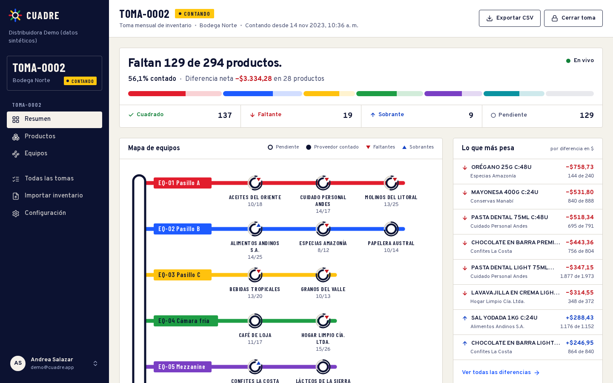
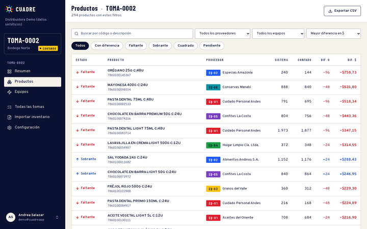
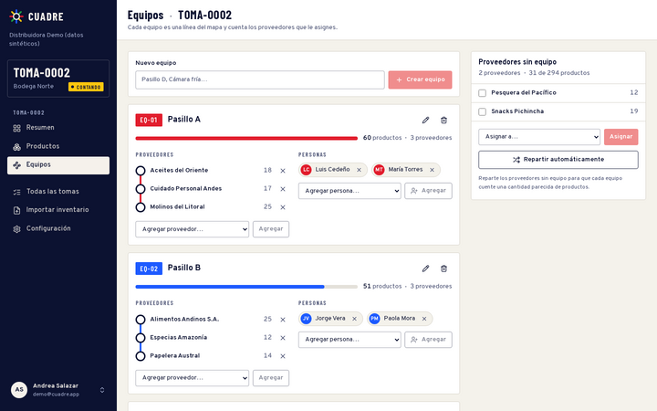
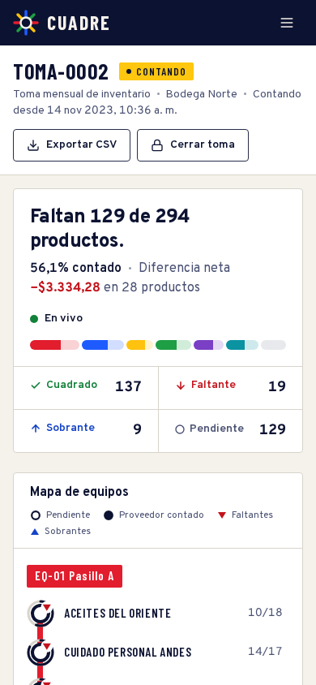
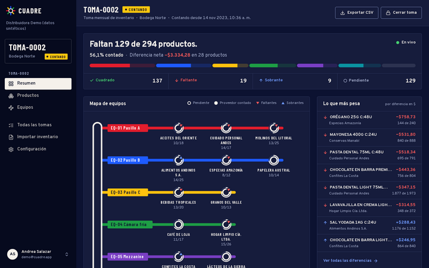

# Cuadre

Live physical stock counts for warehouses. Import the accounting system's stock file, split suppliers across counting teams and watch shortages and overages, valued in dollars, appear as counts arrive.



Every team is drawn as a transit line and every supplier as a station. A station's ring fills as its products are counted, and markers flag shortages and overages. The supervisor sees in seconds how much is left, which team is behind and where the money is.

## Features

- **Guided CSV import.** Reads the `SALDO;CODIGO_PRODUCTO;...` export as accounting systems produce it: UTF-8 BOM, semicolons, decimal commas, `#DIV/0!` values. Every row is validated with its line number before anything is written, and the server re-parses the upload and stores it atomically.
- **Live overview.** Progress per team, net dollar difference, the most expensive differences and the latest counts, streamed over Supabase Realtime.
- **Product table.** Server-side search, filters (status, supplier, team), sorting by dollar impact and pagination. A side panel shows each count event (pallets × layers × boxes × units per box + loose units) and lets supervisors request a recount. <kbd>J</kbd> / <kbd>K</kbd> move through the list.
- **Teams.** Create teams, assign people and suppliers, or balance unassigned suppliers automatically by product count.
- **Roles and invitations.** Admins import and close sessions, supervisors organize teams and recounts, and counters only count their own team's suppliers. Invitations by email become memberships on first sign-in.
- **Export.** One CSV per session with system vs counted stock, differences and status, ready for Spanish-locale spreadsheets.
- **Accessible and themable.** WCAG 2.1 AA in light and dark themes (checked with axe on every screen), and a phone layout that turns the map into strip maps.

| Products                                   | Teams                                | Phone                                 |
| ------------------------------------------ | ------------------------------------ | ------------------------------------- |
|  |  |  |



## Stack

- **Next.js 14** (App Router, Server Components, Server Actions), React 18, TypeScript strict
- **Supabase**: Postgres with Row Level Security, Auth, Realtime and SQL migrations
- **Tailwind CSS** with Radix primitives and a token-based design system (light and dark)
- **Testing**: Vitest (parsing, formulas, balancing), pgTAP (RLS and business rules), Playwright (end-to-end flows plus axe accessibility checks)
- **CI**: GitHub Actions

## Data model

```
organizations ─┬─ memberships (admin · supervisor · counter) ── auth.users
               ├─ invitations
               ├─ warehouses, suppliers
               └─ count_sessions (TOMA-0001…) ─┬─ session_products (stock snapshot)
                                               ├─ teams (EQ-01…) ── team_members, team_suppliers
                                               └─ counts ── total = pallets × layers × boxes × units/box + units
```

The reconciliation lives in SQL views (`session_product_status`, `supplier_progress`, `session_summary`) that run as the caller, so Row Level Security applies to every number on screen. Counts are designed to come from a companion mobile app: the RLS policies already restrict counters to their team's suppliers while a session is counting.

## Getting started

Requirements: Node 22 or newer, pnpm, Docker.

```bash
pnpm install
cp .env.example .env.local      # local Supabase URL and anon key
pnpm db:start                   # starts Supabase, applies migrations and seed data
pnpm dev
```

Open http://localhost:3000 and sign in with the demo account `demo@cuadre.app` / `cuadre-demo`. All demo data is synthetic. To try the importer, create a new account and upload `fixtures/inventory-sample.csv`.

## Scripts

| Command                        | What it does                                        |
| ------------------------------ | --------------------------------------------------- |
| `pnpm dev`                     | Development server                                  |
| `pnpm lint` / `pnpm typecheck` | ESLint and TypeScript                               |
| `pnpm test`                    | Unit tests (Vitest)                                 |
| `pnpm test:db`                 | Database tests (pgTAP) against the local stack      |
| `pnpm test:e2e`                | End-to-end and accessibility tests (Playwright)     |
| `pnpm db:reset`                | Rebuild the local database from migrations and seed |
| `pnpm db:types`                | Regenerate TypeScript types from the schema         |

## Project structure

```
app/                 routes: (auth), (onboarding), (app)/tomas/[code]/{productos,equipos,exportar}, configuracion
components/          overview (network map, live hook), products, teams, settings, shell, ui primitives
lib/                 csv parser, count rules, queries and server actions per domain, Supabase clients
supabase/            migrations, seed and pgTAP tests
e2e/                 Playwright journeys and accessibility checks
```
